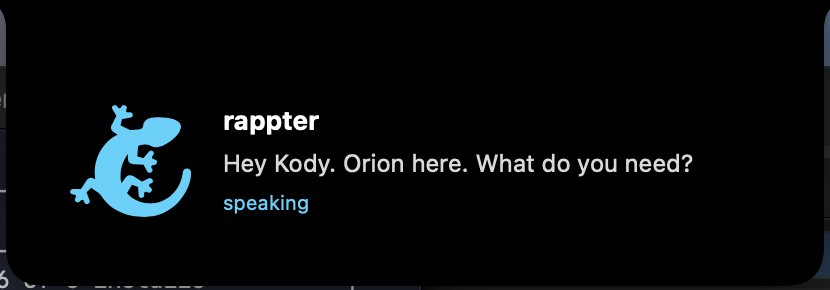

<div align="center">

# OpenRappter

### A creature that lives in your Mac's notch. Hold a key and talk.

It thinks through the GitHub Copilot sign-in you already have. No new API keys, no new accounts, no new monthly bill. Your voice is turned into words on your Mac; only the words go to GitHub Copilot, through your own sign-in.

[](LICENSE)
[](https://github.com/kody-w/openrappter/releases)

**[Download for Mac](https://github.com/kody-w/openrappter/releases/latest)** · [Website](https://kody-w.github.io/openrappter/) · [How it works](#how-it-works) · [v1 (the gateway)](#v1)



</div>

## What it does

| Hold | It |
|---|---|
| **⌥ Space** | listens, thinks, answers out loud |
| **⌃⌥ Space** | types what you said into whatever app you are in |
| **⇧⌥ Space** | reads the window in front of you and answers about it |

When something needs you, the creature changes posture and waits in the notch. Claude Code's permission prompts can show there too, with **Allow once · No · Always** buttons, so you answer from the notch instead of hunting for the terminal.

No needs are invented. It never speaks first. One action per card.

## Install

1. `brew tap kody-w/tap && brew trust kody-w/tap && brew install --cask openrappter`, or download the `.dmg` from the latest `vX.Y.Z-app` [release](https://github.com/kody-w/openrappter/releases/latest), drag **OpenRappter** to Applications, and launch it.
2. A setup card appears in the notch with four powers: **Hear you**, **Understand you**, **Type for you**, **See your screen**. Allow each one, or press **Later**. The hold-keys start working once that card is gone.
3. Meanwhile it finds or starts its own mind on `127.0.0.1:18790`. The first time this clones the kernel from GitHub and takes a few minutes, so it needs an internet connection and Apple's command line tools (`git` and `python3`; macOS offers to install them).
4. When the mind is up but not signed in, the creature says it is hungry and shows one button: **Sign me in**. It copies a short GitHub code to your clipboard and opens the GitHub page; paste the code, approve, and the creature notices on its own.
5. Hold **⌥ Space** and talk.

Signed with Apple Developer ID and notarized. macOS 14 or later, Apple Silicon and Intel.

## How it works

OpenRappter is a thin native face over an unchanged [RAPP Brainstem](https://github.com/kody-w/rapp-installer) kernel, pinned by commit in [`app/kernel/kernel.json`](app/kernel/kernel.json). The app only ever talks to it through `GET /health`, `POST /chat` and `POST /login` (which starts the GitHub sign-in). If you already run a Brainstem on `:7071`, OpenRappter uses it. Otherwise it runs its own copy as a login service on `127.0.0.1:18790`, in `~/.openrappter/kernel`, and that kernel keeps working after you quit the app.

- **Speech** is recognised on your Mac when Apple supports on-device recognition for your language; otherwise Apple's speech servers do it. Answers are spoken with the system voice.
- **Typing for you** needs Accessibility; **reading your screen** needs Screen Recording. Both are asked once, both are off until you say yes.
- **Needs** are JSON files in `~/.openrappter/needs/`. Anything can drop one: the included Claude Code hook, a cron job, a script. Answers land next to them as `<id>.answer.json`.
- **Ask about my screen** takes a picture of the window in front of you, turns it into text on your Mac, and sends that text with your question to the kernel, which sends it to GitHub Copilot. Nothing is read until you hold the key.
- **No home to phone.** The app itself talks only to the kernel on your own Mac. The kernel sends what you ask (and, for screen questions, that window's text) to GitHub Copilot with your own sign-in, and clones itself from GitHub the first time.

### Connect Claude Code

Menu bar → **Connect Claude Code**. It adds one hook to `~/.claude/settings.json`. Permission prompts, idle waits and finished turns then show in the notch. Unanswered cards fall back to the normal terminal prompt after 55 seconds.

### Build it yourself

```bash
cd app && swift test && VERSION=2.0.0 bash scripts/build-app.sh   # dist/OpenRappter.app, ad-hoc signed
```

## v1

OpenRappter 1.x was a TypeScript and Python agent gateway with twenty chat channels. It still works and its install URLs still resolve, but it is **retiring**: v2 keeps the `/chat` contract and the creature, and leaves channels to [Hermes Agent](https://github.com/NousResearch/hermes-agent) in front of a Brainstem. The v1 docs are in [`docs/v1/README-v1.md`](docs/v1/README-v1.md), the code at tag [`legacy-v1`](https://github.com/kody-w/openrappter/tree/legacy-v1), and the old web dashboard at [`dashboard.html`](https://kody-w.github.io/openrappter/dashboard.html).

## License

MIT.
